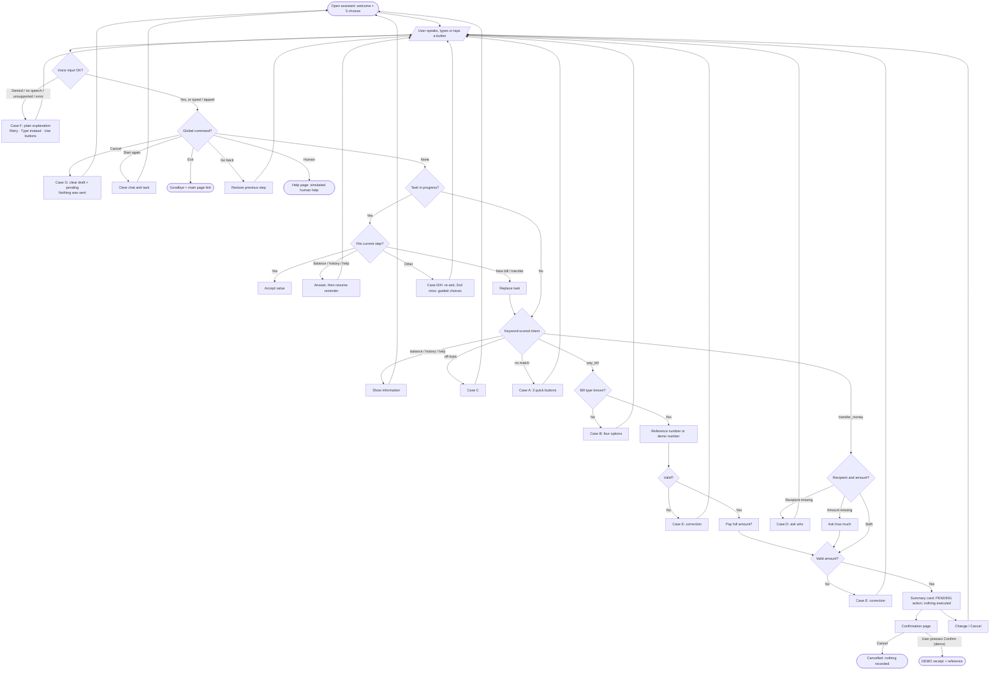

# AwaazPay: A Voice-First, Urdu-Friendly Conversational Interface for Routine Digital Finance Tasks

**Course:** Human Computer Interaction (HCI) — Assignment #2
**Department of Computer Sciences, Bahria University, Islamabad Campus**
**Student:** [Your name] · **Enrolment no.:** [Your enrolment number] · **Instructor:** [Instructor name]
**Date:** [Submission date]
**Prototype:** `awaazpay/` (open `index.html`), demo video: [link to be added]

> **Status.** Prototype complete; automated checks only (Section 9). **No real-user testing yet;** Section 12 is pending.

---

## 1. Abstract

Many first-time digital finance users find conventional banking applications intimidating because they depend on English terminology, nested menus and forms. This report describes the design, implementation and planned evaluation of AwaazPay, a voice-first, Urdu-friendly prototype for simulated bill payment, money transfer, balance checking and transaction review. It combines a rule-based conversational assistant with large-button pages, right-to-left Urdu support, visible system status, plain-language error recovery, and a review-then-confirm pattern in which voice alone never completes a payment. Design decisions are mapped to Norman, Nielsen, Shneiderman, Grice and WCAG 2.1. The prototype uses HTML, CSS and vanilla JavaScript with fictional data only. A pilot study with 5–8 participants is planned; no results are reported because testing has not yet taken place.

## 2. Introduction and Problem Statement

Routine financial tasks such as paying a utility bill or sending money to a relative are common, yet the interfaces that support them often assume digital confidence. Conventional applications rely on small text, abbreviations, English-only labels and multi-field forms. For an older adult new to smartphones, a slow reader, or someone who prefers Urdu, each is a barrier, and mistakes (money sent to the wrong place) are costly, so anxiety is rational.

Norman (2013) describes two gulfs that users must cross: the *gulf of execution*, between what a person wants to do and the actions the system offers, and the *gulf of evaluation*, between the system's state and the person's ability to interpret it. Voice and conversation can narrow the first gulf, because people already know how to state a goal in their own language. They can also widen the second if the system acts on misheard input or hides what it understood. The design problem is therefore not simply "add a microphone" but to let people state goals naturally while keeping every consequential step visible, reversible and under their control.

**Problem statement.** How can a conversational interface help first-time, Urdu-preferring users complete routine finance tasks confidently while preventing accidental or misunderstood transactions?

## 3. Project Proposal and Target Users

AwaazPay is an educational prototype, not a banking product. It supports nine simulated tasks: pay an electricity, gas, water or internet bill; send money to a saved contact; check a balance; review recent transactions; get help; recover from a wrong selection or misheard command; cancel before confirmation; restart or exit; and request (simulated) human help.

Three representative user groups guided the design: older adults with limited finance-app experience; users with low digital or reading literacy who need step-by-step guidance; and Urdu-speaking users uncomfortable with English-only interfaces. These are design assumptions. Vision, hearing, confidence and familiarity vary within each group, so the prototype offers several routes rather than one assumed "accessible" mode: speech, typing, buttons, text with every spoken reply, and a language switch.

**Safety boundary.** All balances, billers, contacts and transactions are fictional. The prototype never connects to a bank or payment service, never asks for a PIN, password, OTP or card number, and shows "Demo Prototype — No real money is transferred." on every page. Receipts carry a DEMO stamp, a diagonal watermark and a reference number beginning `DEMO-`.

## 4. User Persona and Context of Use

*The personas below are fictional design personas derived from the assignment's target groups. They are not real participants.*

**Primary persona: Rukhsana Bibi, 61.** Prefers Urdu. Uses a smartphone for calls and family photos; limited experience with financial apps. Wears reading glasses and increases the phone's font size. *Goals:* pay the electricity bill without asking a relative; send money to her son when needed. *Frustrations:* English menu names, small buttons, not knowing whether a payment "went through". *Context:* at home, in the afternoon, often with television noise; sometimes with a weak data connection. *Scenario:* the bill is due; she opens AwaazPay, says "مجھے بجلی کا بل ادا کرنا ہے", sees her words written on screen, checks the amount on a large summary, and presses the confirmation button herself, then reads the demo receipt.

**Secondary persona: Imran, 34.** Shop assistant; speaks Urdu and some English; comfortable with voice notes but reads English slowly. *Goals:* quick transfers to a supplier. *Frustrations:* long forms, jargon. *Scenario:* in a noisy shop he switches to buttons and completes a transfer, showing why every voice task must work without voice.

**Assistant tone.** Respectful, patient, calm, non-judgmental, simple, never patronising, and clear about consequences. Examples:

- Unrecognised input: "معاف کیجیے، میں آپ کی بات سمجھ نہیں سکا۔ آپ بل ادا کر سکتے ہیں، پیسے بھیج سکتے ہیں، یا اپنا بیلنس دیکھ سکتے ہیں۔" / "Sorry, I did not understand that. You can pay a bill, send money, or check your balance."
- Review: "Please check the details below. Nothing has been paid yet. To continue, open the confirmation page, where you press the final button yourself."
- Cancellation: "OK, I cancelled that. Nothing was sent and no money was taken."

## 5. Refined Requirements and Priorities

Requirements follow the form "The interface shall [behaviour] so that [user benefit]." "Verification" describes how each is checked; where a method is planned rather than done, it is marked *planned*. No feedback has been collected yet, so the last column records only that no change has been made.

| ID | Requirement | Priority | HCI principle | Verification | Change after feedback |
|---|---|---|---|---|---|
| FR1 | The interface shall let users complete every task by speaking, typing or pressing buttons so that no one is excluded by an input method. | Must | Universal usability (Shneiderman); WCAG 2.1 | Implemented; *planned* user test | None yet (no feedback) |
| FR2 | The interface shall show a full summary and require a separate final confirmation so that a misheard or mistaken request cannot become a payment. | Must | Error prevention (Nielsen); stage 7 evaluation (Norman) | Implemented; scripted checks | None yet |
| FR3 | The interface shall let users cancel, go back one step, restart or exit at any point so that they stay in control. | Must | User control and freedom; easy reversal | Implemented; scripted checks | None yet |
| FR4 | The interface shall explain errors in plain language with a next action so that users can recover without technical knowledge. | Must | Help users recover from errors | Implemented (A–H); *planned* observation | None yet |
| FR5 | The interface shall display system status (idle, listening, processing, speaking, error) so that users know what the system is doing. | Must | Visibility of system status | Implemented; scripted status checks | None yet |
| FR6 | The interface shall label all data and receipts as demonstration so that no one believes real money moved. | Must | Grice: Quality; trust | Implemented; checked on every page | None yet |
| NFR1 | The interface shall support Urdu (right-to-left) and English so that users can work in their preferred language. | Must | Match between system and real world | Implemented; *planned* review by an Urdu speaker | None yet |
| NFR2 | The interface shall use large targets (≥ 48 px), high contrast and keyboard operation so that people with limited vision or dexterity can use it. | Should | WCAG 2.1 | Implemented; contrast computed; *planned* keyboard run | None yet |
| NFR3 | The interface shall degrade gracefully when speech recognition or voices are unavailable so that voice failure never blocks a task. | Must | Error prevention; resilience | Implemented; mocked-error checks; *planned* device check | None yet |
| NFR4 | The assistant shall ask one short question at a time so that users are not overloaded. | Should | Grice: Quantity, Manner; reduce memory load | Implemented; *planned* user observation | None yet |

## 6. Conversational Design and Intent Catalogue

The assistant is a **transparent rule-based engine**, not AI or machine learning. Input is normalised (case, Urdu/Arabic letter variants, Urdu digits), then checked in order: global commands (cancel, restart, exit, back, human help); the current dialogue step; and keyword-scored intents. Amounts accept digits, "2k", and simple Urdu/Roman number words ("پانچ ہزار", "do hazar").

| Intent | Purpose | Example utterances | Reply and choices | Recovery |
|---|---|---|---|---|
| `pay_bill` | Start a simulated bill payment | "Pay my electricity bill"; "مجھے بجلی کا بل ادا کرنا ہے"; "Mera bill pay karna hai"; "Internet ka bill bharna hai" | Reference (or demo number) → amount → review | Unknown type: four buttons; bad value: say why, offer fix |
| `transfer_money` | Start a simulated transfer | "Send money to Ahmed"; "Paise bhejne hain"; "مجھے پیسے بھیجنے ہیں"; "Fatima ko 1000 bhejo" | Recipient and/or amount (keeps what was given) → review | Only missing field asked; invalid amount explained |
| `check_balance` | Show the demo balance | "How much money do I have?"; "Check my balance"; "میرا بیلنس بتائیں"; "Balance batao" | Balance, marked fictional | Mid-task: answers, then resumes |
| `transaction_history` | Show recent demo transactions | "Show my recent transactions"; "Transaction history"; "میرا لین دین دکھائیں"; "Statement dikhao" | Three latest + full list link | As above |
| `help` | Explain abilities; hand off | "Help me"; "مدد چاہیے"; "Madad karo"; "I want to talk to a human" | Abilities summary; help page; simulated human request | No real contact promised |
| `cancel_or_restart` | Cancel, start again, exit | "Cancel"; "Start again"; "منسوخ کریں"; "Band karo" | Clears draft and pending action | Works at every step |

**Error cases implemented.** A: unrecognised input (three quick buttons). B: ambiguous "I need to pay" (four bill types). C: off-topic (polite refusal, route to main page). D: missing information (only the missing field is asked). E: invalid amount or reference (specific message, e.g. negative, decimal, above balance, wrong length, wrong bill type). F: speech failure (permission denied, nothing heard, no microphone, network, unsupported language: retry, type, or buttons). G: cancellation. H: repeated misunderstanding (guided choices, help page, restart).

## 7. Interaction Model and Dialogue Flowchart

A user (1) opens the assistant, which greets them with five choices; (2) discovers capabilities from those buttons, the help intent and "Try saying" examples; (3) states a request by voice, text or button; (4) is asked a question only when information is missing; (5) reviews a summary card; (6) confirms on a separate page, or cancels or changes; (7) receives a fictional DEMO receipt; and (8) continues, restarts or exits. The flowchart below matches `js/conversation.js` (also saved as `docs/dialogue-flowchart.mmd`).

## 8. Mapping to Norman's Stages of Action

| Stage | Interface support |
|---|---|
| Goal | Dashboard cards and welcome message name the possible goals in everyday words |
| Intention | Assistant asks one question ("Which bill?") so intent becomes specific |
| Action specification | Quick-reply buttons, demo reference chip and amount presets show valid inputs (recognition over recall) |
| Execution | Speak, type or tap; large targets; push-to-talk mic |
| Perception | Live transcript, chat bubbles, status bar with text and icon |
| Interpretation | Plain-language replies; amounts in rupees; "nothing has been paid yet" |
| Evaluation | Summary card, confirmation page showing balance after, DEMO receipt matching the reviewed details, transaction list entry |

The *gulf of execution* is reduced by three input routes and prompts offering valid answers; the *gulf of evaluation* by showing what the system understood (transcript) and what will happen (summary).

## 9. Prototype Implementation

The prototype has ten linked pages (landing, dashboard, voice assistant, pay bill, transfer money, balance, transactions, help, confirmation, receipt), three CSS files and nine JavaScript modules, with no framework, backend or database. State (language, balance, pending action, receipt, chat) is kept in `localStorage`, which is **not secure storage** and is used only so the demonstration works across pages.

**Speech.** Recognition uses `SpeechRecognition`/`webkitSpeechRecognition` with the language set to `ur-PK` or `en-US`; spoken replies use `speechSynthesis` only if the device has a voice for the selected language, because reading Urdu with an English voice would be misleading. Support varies by browser, so the prototype detects capabilities, explains limitations and never makes voice mandatory. The assistant is push-to-talk: speaking cancels listening and starting to listen cancels speech, so it cannot hear itself.

**Safety by construction.** The engine can only create a *pending* action. The sole code that records a simulated payment is the confirmation page's button handler, which ignores scripted clicks and double clicks; the page tells users that the assistant never presses it for them.

**Verification performed.** Scripts loaded the real code in a simulated DOM (jsdom) and ran 98 engine checks (all example utterances, error cases, undo, cancel, restart, validators) and 806 page checks (links, translation keys, page flows, language switch, mocked speech errors); all passed in the final run. **These are not usability tests, and were not run in real browsers, with a real microphone or with Urdu voices.**

## 10. HCI Principles and Design Rationale

**Nielsen's heuristics (Nielsen, 1994).** *Visibility of system status:* the status bar names five states with text and an icon shape, not colour alone. *Match with the real world:* "ریفرنس نمبر", "بل", rupee amounts and Roman Urdu understanding. *User control and freedom:* Back, Cancel, Start again, Exit on the assistant; Cancel on every form step and Back from step 2 onward; "Change details" on confirmation. *Consistency and standards:* the same header, banner and button styles on all pages; the same verbs in the form and in the chat. *Error prevention:* validation of reference and amount, review step, separate confirmation. *Recognition rather than recall:* demo reference chip, contacts and quick amounts. *Recover from errors:* cases A–H. *Help and documentation:* help page with FAQ, capability check and "what it cannot do".

**Shneiderman's Eight Golden Rules (Shneiderman et al., 2016).** Consistency (shared layout); informative feedback (transcript, status, receipt); error prevention and easy reversal (review, undo one step, cancel); reduce short-term memory load (one question at a time, visible summary); user control (nothing happens without the user's final press); and, for universal usability, three input modes and two languages.

**Grice's maxims (Grice, 1975).** *Quantity:* replies give what is needed for the next step. *Quality:* the assistant says it is a demo, that balances are fictional, and does not claim to understand when it does not. *Relation:* off-topic requests are declined politely and redirected. *Manner:* short sentences, one question, no jargon.

**Accessibility and inclusion (W3C, 2018).** Semantic landmarks, skip link, labelled controls, visible focus, 48 px targets, live regions for status and chat, text for every spoken reply, `dir="rtl"` for Urdu with numerals and amounts isolated left-to-right, contrast ratios of at least 5.1:1 for text and 3.5:1 for input borders (computed), reduced-motion support, and responsive layouts.

**Per-page rationale.** *Landing:* language first, two entry routes, safety notice before use. *Dashboard:* five large labelled cards and one prominent microphone. *Assistant:* conversation, controls and a privacy note, since comfort with speech differs. *Forms:* "Step n of N", one decision per screen. *Confirmation and receipt:* plain summary, balance after, unmistakable DEMO identity. *Balance and history:* plain wording; failed items say no money was taken. *Help:* honest limits and a clearly simulated human-help route.

## 11. Usability Evaluation Methodology

A small pilot of about 5–8 participants from the target groups is planned (older relatives and neighbours, adults with limited digital experience, Urdu-preferring adults), recruited voluntarily, with no incentive that could pressure consent. Small samples can reveal major problems in formative testing (Nielsen & Landauer, 1993; Faulkner, 2003) but cannot support statistical claims, and none will be made.

Each session (about 20 minutes) follows a consent script, a brief profile sheet, five tasks (pay a bill by voice; send money by buttons; check balance and find the latest transaction; recover from a deliberately unclear command; cancel before confirming), observation on a recording sheet, a short questionnaire and an interview. Participants never enter real financial data. Only the minimum data is collected: a participant code, age band, language preference and experience; no names, no audio or video recording unless separately consented. Outcomes: (1) task completion rate = successful tasks ÷ attempted tasks; (2) time on task from first action to receipt or cancellation; (3) errors and assistance requests per task; (4) ease and confidence ratings on a 1–5 scale. Success criteria are set in the appendix. An optional System Usability Scale (Brooke, 1996) will be reported only if actually administered, with care over translation and comprehension. Full materials and blank result tables are in `docs/03-appendices-testing.md`.

## 12. Results and Discussion

**PENDING — no real-user testing has been conducted.** After testing, insert: participant profile table; completion, time, error and rating tables from the appendix; two or three observed problems with a proposed design change each; and a discussion relating findings to the principles above. Do not include any figure that was not recorded. Any change made after feedback should be added to the requirements table, in the "Change after feedback" column, with the participant evidence that motivated it.

## 13. Limitations and Future Improvements

The assistant is keyword-based, so unusual phrasing, dialects and code-switching will fail, and Roman Urdu spelling varies widely. Urdu recognition and voices depend on browser and device, and Chrome may use an online service. Number-word parsing is limited. There is no authentication, banking integration or post-confirmation reversal, by design, and `localStorage` is not secure. Layouts have not been verified on physical devices. Future work: native-speaker review of Urdu wording; screen-reader testing; adjustable speech rate; a "teach-back" step where the assistant reads the amount aloud before confirmation; and the real evaluation.

## 14. Conclusion

AwaazPay demonstrates how a conversational, bilingual and voice-capable interface can be built around safety and recoverability for people who find standard finance apps difficult. Its central decision, that voice may prepare a task but only the user's own press can complete it, addresses the main risk of voice input in finance. Whether the design achieves its goals for real users remains to be shown by the planned pilot study.

## 15. References

*(Entries below were written from the author's knowledge of standard HCI sources and have **not** been re-verified online. Check each against the publisher or Google Scholar record, and add page numbers or DOIs where required, before submission. Add at least two peer-reviewed sources on digital financial inclusion and on older adults' use of technology or voice interfaces after searching; none are cited above because none were verified.)*

Brooke, J. (1996). SUS: A "quick and dirty" usability scale. In P. W. Jordan, B. Thomas, B. A. Weerdmeester, & I. L. McClelland (Eds.), *Usability evaluation in industry* (pp. 189–194). Taylor & Francis.

Faulkner, L. (2003). Beyond the five-user assumption: Benefits of increased sample sizes in usability testing. *Behavior Research Methods, Instruments, & Computers, 35*(3), 379–383.

Grice, H. P. (1975). Logic and conversation. In P. Cole & J. L. Morgan (Eds.), *Syntax and semantics: Vol. 3. Speech acts* (pp. 41–58). Academic Press.

Nielsen, J. (1994). Enhancing the explanatory power of usability heuristics. In *Proceedings of the SIGCHI Conference on Human Factors in Computing Systems (CHI '94)* (pp. 152–158). ACM.

Nielsen, J., & Landauer, T. K. (1993). A mathematical model of the finding of usability problems. In *Proceedings of INTERCHI '93* (pp. 206–213). ACM.

Norman, D. A. (2013). *The design of everyday things* (Revised and expanded ed.). Basic Books.

Shneiderman, B., Plaisant, C., Cohen, M., Jacobs, S., & Elmqvist, N. (2016). *Designing the user interface: Strategies for effective human-computer interaction* (6th ed.). Pearson.

W3C. (2018). *Web Content Accessibility Guidelines (WCAG) 2.1*. https://www.w3.org/TR/WCAG21/

W3C Web Platform Incubator Community Group. (n.d.). *Web Speech API*. https://webaudio.github.io/web-speech-api/

## 16. Appendices

Appendix A (test tasks), B (consent script), C (profile sheet, recording sheet, questionnaire, interview guide, analysis method, blank results tables) and D (screenshot checklist) are in `docs/03-appendices-testing.md`. The demo-video script and submission checklist are in `docs/04-demo-video-and-submission.md`.
